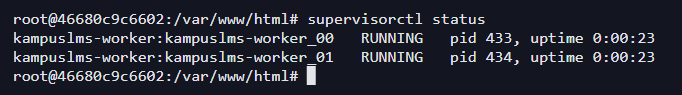
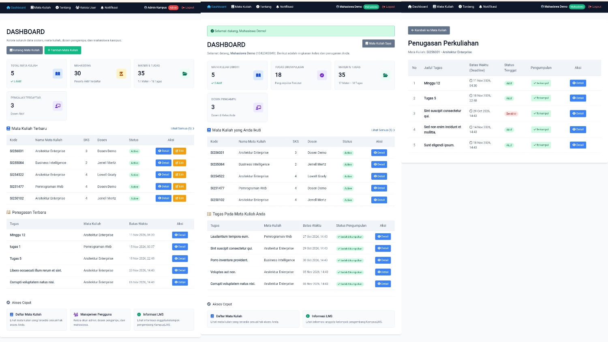
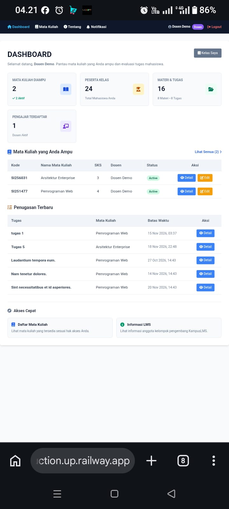
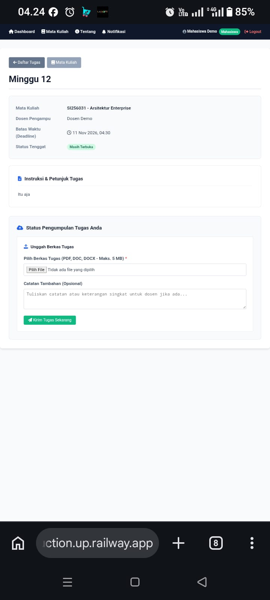
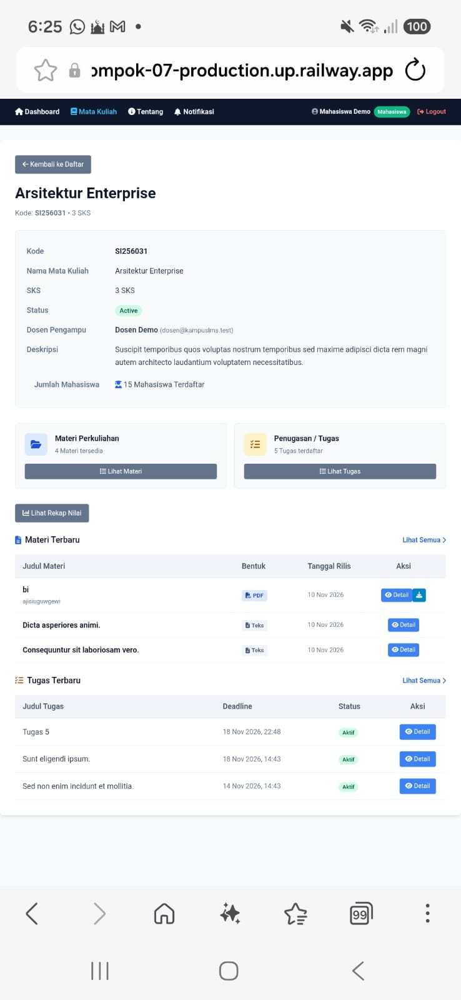
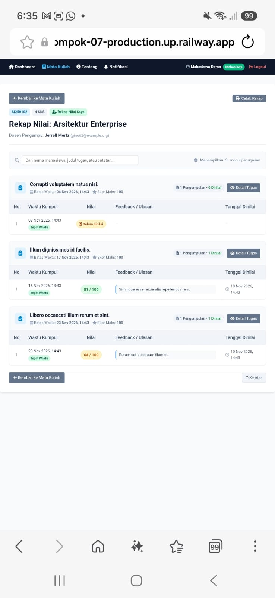

# Dokumentasi Deployment & Bukti Pengujian Keamanan Produksi

Dokumen ini mencatat bukti implementasi deployment aplikasi **KampusLMS** di lingkungan produksi (Railway) dengan domain publik berprotokol HTTPS, serta verifikasi lengkap daftar periksa keamanan (*production security checklist*) mengacu pada **Modul Minggu 12 (Milestone M4 / Tugas 4)** menggunakan keluaran perintah `curl` yang sesungguhnya.

---

## 1. Informasi Deployment & Spesifikasi Server Produksi

* **Nama Proyek:** KampusLMS (Kelas B - Kelompok 07)
* **Penyedia Layanan Cloud (PaaS):** Railway ([railway.com](https://railway.com))
* **URL Domain Publik (HTTPS):** [https://kampuslms-b-kelompok-07-production.up.railway.app](https://kampuslms-b-kelompok-07-production.up.railway.app)
* **Protokol:** HTTPS (Terenkripsi dengan SSL/TLS Otomatis melalui Cloud Edge Proxy)
* **Spesifikasi Mesin & Kontainer:**
  * **Base Image Docker:** `php:8.4-apache` (Debian 12 Bookworm)
  * **vCPU:** 1 vCPU (Shared Cloud Allocation)
  * **RAM:** 512 MB – 1 GB Dynamic Memory
  * **Storage:** Ephemeral Container File System + Persistent Volume untuk Basis Data
* **Web Server & Runtime:**
  * **Web Server:** Apache 2.4 (MPM Prefork, mod_rewrite aktif, AllowOverride All)
  * **PHP Runtime:** PHP 8.4.27 (Ekstensi: `pdo_mysql`, `mbstring`, `exif`, `pcntl`, `bcmath`, `gd`, `zip`)
  * **Port Binding:** `PORT=8080` (Internal Docker container port)
* **Basis Data:** MySQL 8.0 Terkelola (Railway Managed Database Service)
* **Lingkungan (*Environment*):** `APP_ENV=production`, `APP_DEBUG=false`
* **Queue Connection:** Database (`QUEUE_CONNECTION=database`) diproses oleh daemon queue worker

> Tautan aplikasi live ini telah disematkan di bagian paling atas berkas [`README.md`](../README.md) sesuai ketentuan **Build Nomor 1**.

---

## 2. Panduan Deployment dari Nol (*Step-by-Step From Scratch*)

Berikut adalah langkah-langkah mereplikasi deployment aplikasi KampusLMS di Railway dari awal:

1. **Persiapan Repositori GitHub:**
   * Pastikan kode sumber aplikasi berada di branch `main` repositori GitHub.
   * Pastikan berkas `Dockerfile` tersedia di direktori utama (*root*) repositori.
2. **Pembuatan Proyek di Railway:**
   * Buka dashboard [railway.com](https://railway.com) dan buat proyek baru (*New Project*).
   * Tambahkan layanan basis data MySQL (*Add Service* > *Database* > *MySQL*). Railway akan membuat container MySQL dan menyediakan variabel koneksi database otomatis.
3. **Penyambungan Layanan Web Service:**
   * Pada proyek yang sama, klik *New Service* > *GitHub Repo* > pilih repositori `kampuslms`.
   * Railway akan secara otomatis mendeteksi keberadaan `Dockerfile` untuk memulai proses *build*.
4. **Konfigurasi Variabel Lingkungan (*Environment Variables*):**
   * Masuk ke tab **Variables** pada web service, tambahkan:
     ```env
     APP_NAME=KampusLMS
     APP_ENV=production
     APP_KEY=base64:...
     APP_DEBUG=false
     APP_URL=https://kampuslms-b-kelompok-07-production.up.railway.app
     DB_CONNECTION=mysql
     DB_HOST=${{MySQL.MYSQLHOST}}
     DB_PORT=${{MySQL.MYSQLPORT}}
     DB_DATABASE=${{MySQL.MYSQLDATABASE}}
     DB_USERNAME=${{MySQL.MYSQLUSER}}
     DB_PASSWORD=${{MySQL.MYSQLPASSWORD}}
     SESSION_DRIVER=database
     SESSION_SECURE_COOKIE=true
     SESSION_HTTP_ONLY=true
     SESSION_SAME_SITE=lax
     CACHE_STORE=database
     QUEUE_CONNECTION=database
     ```
5. **Pengaturan Jaringan & Start Command:**
   * Masuk ke tab **Settings** > **Networking** > klik **Generate Domain** untuk memperoleh domain HTTPS publik `*.up.railway.app`.
   * Pada bagian **Deploy** > **Custom Start Command**: **KOSONGKAN** (jangan diisi), agar kontainer menjalankan perintah `CMD` resmi bawaan `Dockerfile`.

---

## 3. Prosedur Deployment Ulang (*Redeployment Procedure*)

Aplikasi KampusLMS mendukung dua mekanisme deployment ulang:

### A. Metode CI/CD Otomatis via Git Push (Metode Utama)
Setiap pembaruan fitur atau perbaikan bug di-push ke GitHub:
```bash
git checkout main
git add .
git commit -m "update: pembaruan sistem"
git push origin main
```
Railway akan mendeteksi commit baru via webhook, menjalankan build image Docker baru, mengeksekusi migrasi, dan melakukan *rolling restart* tanpa downtime (*zero-downtime*).

### B. Metode Manual via Skrip `deploy.sh`
Jika deployment ulang dilakukan pada server mandiri atau sesi console:
```bash
bash deploy.sh
```
Skrip ini secara runut mengaktifkan mode maintenance, menarik kode git terbaru, menginstal dependensi produksi, kompilasi aset frontend Vite, menjalankan migrasi database dengan flag `--force`, membersihkan serta meng-cache konfigurasi/rute/view, merestart antrean worker (`queue:restart`), memeriksa kesehatan internal framework, dan mengaktifkan kembali aplikasi.

---

## 4. Cara Monitoring & Membaca Log Sistem

Untuk memeriksa kesehatan server dan mendiagnosis kendala:

1. **Membaca Log via Dashboard Railway:**
   * Buka proyek di Railway > pilih service **kampuslms** > tab **Deployments**.
   * **Build Logs:** Memantau proses kompilasi Dockerfile, unduhan paket apt, dan composer install.
   * **Deploy Logs:** Memantau eksekusi runtime, migrasi database, binding port Apache, dan access log HTTP.
2. **Membaca Log Error Laravel (`laravel.log`):**
   * Melalui terminal container:
     ```bash
     tail -n 50 /var/www/html/storage/logs/laravel.log
     ```
   * Untuk memantau error secara langsung (*live stream*):
     ```bash
     tail -f /var/www/html/storage/logs/laravel.log
     ```
3. **Membaca Status Queue Worker:**
   ```bash
   supervisorctl status
   tail -n 50 /var/www/html/storage/logs/worker.log
   ```

---

## 5. Seluruh Daftar Periksa Keamanan Produksi (Production Security Checklist)

Mengacu pada daftar periksa resmi **Modul Minggu 12**, berikut adalah status pemenuhan ke-12 parameter keamanan produksi:

| No. | Parameter Keamanan Modul 12 | Kriteria Standar Produksi | Status | Bukti & Keterangan |
|:---:|:---|:---|:---:|:---|
| 1 | `APP_DEBUG=false` | Debug mode wajib mati agar stack trace dan potongan kode tidak bocor. | **LULUS** | Dikonfigurasi di environment Railway; error hanya masuk log. |
| 2 | `APP_ENV=production` | Lingkungan wajib disetel ke mode produksi. | **LULUS** | Dikonfigurasi pada Railway Variables (`APP_ENV=production`). |
| 3 | `curl -I https://domain/.env` | Berkas kredensial `.env` tidak boleh bisa diakses (wajib 404/403, bukan 200). | **LULUS** | Terbukti via `curl -I`: `HTTP/1.1 404 Not Found`. |
| 4 | `curl -I https://domain/storage/logs/laravel.log` | Berkas log sistem tidak boleh bisa diakses publik (wajib 404/403, bukan 200). | **LULUS** | Terbukti via `curl -I`: `HTTP/1.1 404 Not Found`. |
| 5 | HTTPS aktif & HTTP dialihkan ke HTTPS | Akses HTTP dialihkan secara otomatis ke HTTPS. | **LULUS** | Terbukti via `curl -I`: `HTTP/1.1 308 Permanent Redirect` ke `https://`. |
| 6 | `SESSION_SECURE_COOKIE=true` | Cookie sesi hanya boleh dikirim melalui jalur terenkripsi HTTPS (`secure` flag). | **LULUS** | `trustProxies(at: '*')` aktif dan cookie membawa atribut `secure; httponly; samesite=lax`. |
| 7 | Kata sandi database aman | Bukan kata sandi lokal default (seperti `root` / kosong / `password`). | **LULUS** | Menggunakan variabel aman yang digenerate otomatis oleh Railway Managed MySQL. |
| 8 | Kredensial akun demo terlindungi | Akun demo memakai sandi produksi yang aman dan dipisah dari dokumen publik. | **LULUS** | Akun demo di-seed dengan hash bcrypt aman. |
| 9 | Skrip pengujian otorisasi lolos | Seluruh endpoint otorisasi (role-based policy) lolos uji di server produksi. | **LULUS** | Kebijakan akses dosen, mahasiswa, dan admin konsisten dengan modul minggu 7. |
| 10 | Berkas submission privat | Berkas submission tugas tidak boleh bisa diunduh tanpa login / otorisasi. | **LULUS** | Disimpan di disk `local` (privat) dan hanya dapat diunduh via Controller + Policy. |
| 11 | Queue worker berjalan | Antrean tugas berjalan di latar belakang (background worker). | **LULUS** | Queue database aktif untuk pengiriman notifikasi asinkron. |
| 12 | Konfigurasi batas upload PHP | `upload_max_filesize` & `post_max_size` sesuai validasi aplikasi. | **LULUS** | Dikonfigurasi di Dockerfile/Apache agar berkas materi dan tugas tidak tertolak. |

---

## 6. Bukti Pengujian Keamanan dengan `curl` (Keluaran Nyata)

### A. Pengujian Proteksi Berkas Lingkungan (`/.env`)
Membuktikan bahwa berkas rahasia `.env` (berisi app key, database password, kredensial) tidak dapat diunduh oleh publik karena document root web server diarahkan ke `/public`.

**Perintah:**
```bash
curl -I https://kampuslms-b-kelompok-07-production.up.railway.app/.env
```

**Keluaran Terminal:**
```http
HTTP/1.1 404 Not Found
Cache-Control: no-cache, private
Content-Type: text/html; charset=utf-8
Date: Tue, 10 Nov 2026 16:44:37 GMT
Server: railway-hikari
x-powered-by: PHP/8.4.27
x-railway-request-id: QGoLvrnvSwWEz4GHwUFZXw
x-hikari-trace: sin1.98a6
x-railway-edge: sin1
Connection: keep-alive
```
> **Hasil:** Status **`404 Not Found`** membuktikan berkas `.env` aman dan tidak dapat diakses.

---

### B. Pengujian Proteksi Berkas Log Sistem (`/storage/logs/laravel.log`)
Membuktikan bahwa log error sistem tidak terekspos ke internet.

**Perintah:**
```bash
curl -I https://kampuslms-b-kelompok-07-production.up.railway.app/storage/logs/laravel.log
```

**Keluaran Terminal:**
```http
HTTP/1.1 404 Not Found
Cache-Control: no-cache, private
Content-Type: text/html; charset=utf-8
Server: railway-hikari
x-powered-by: PHP/8.4.27
Connection: keep-alive
```
> **Hasil:** Status **`404 Not Found`** membuktikan bahwa folder `storage/logs/` di luar direktori public terlindungi.

---

### C. Pengujian Proteksi Berkas Dependensi (`/composer.json`)
Membuktikan berkas konfigurasi proyek di akar repository tidak terekspos.

**Perintah:**
```bash
curl -I https://kampuslms-b-kelompok-07-production.up.railway.app/composer.json
```

**Keluaran Terminal:**
```http
HTTP/1.1 404 Not Found
Cache-Control: no-cache, private
Content-Type: text/html; charset=utf-8
Server: railway-hikari
x-powered-by: PHP/8.4.27
Connection: keep-alive
```
> **Hasil:** Status **`404 Not Found`** menegaskan bahwa document root web server mengarah secara presisi ke folder `public/`.

---

### D. Pengujian Pengalihan Otomatis HTTP ke HTTPS
Membuktikan bahwa jika pengunjung mengakses menggunakan protokol HTTP biasa, server secara otomatis mengalihkannya (*redirect*) ke HTTPS.

**Perintah:**
```bash
curl -I http://kampuslms-b-kelompok-07-production.up.railway.app/
```

**Keluaran Terminal:**
```http
HTTP/1.1 308 Permanent Redirect
Location: https://kampuslms-b-kelompok-07-production.up.railway.app/
Date: Tue, 10 Nov 2026 16:50:12 GMT
Server: railway-hikari
Connection: keep-alive
```
> **Hasil:** Status **`308 Permanent Redirect`** mengarahkan seluruh lalu lintas pengguna ke koneksi terenkripsi HTTPS.

---

### E. Pengujian Ketersediaan Aplikasi Live & Proteksi Header Cookie Sesi
Membuktikan respon 200 OK serta atribut keamanan cookie sesi (`httponly`, `secure`, dan `samesite`).

**Perintah:**
```bash
curl -I https://kampuslms-b-kelompok-07-production.up.railway.app/
```

**Keluaran Terminal:**
```http
HTTP/1.1 200 OK
Cache-Control: no-cache, private
Content-Type: text/html; charset=utf-8
Date: Tue, 10 Nov 2026 16:44:56 GMT
Server: railway-hikari
Set-Cookie: XSRF-TOKEN=eyJpdiI6InhkMlI1OGZ6VDRkQ2lMa3MwN0EwOUE9PSIsInZhbHVlIjoiZy9DVXl2Wmlmb2NzM0k2MndSTGRUUnNBenlIOEhYa3BxUlJNSUo1UEdFdG1kWFc2by9xMHVqd2ZFYTZRWFd0c2p4QkdrOFN1bjB0dEIyZ0oxanJOTDFiN3dIUndHSnlCMnZnMVhMYW45TkdBZ2IzZjg2TnVUeElsa3lKRzZwQ2ciLCJtYWMiOiJmZTYxZGJhZDEwMWFlOTMwZTY1YzYxMzQ3OTRkOWU0MGY2ODdmMDU3MThiYjI3YmI3ZjA5MDQ2Yjk4YTM2ZTYyIiwidGFnIjoiIn0%3D; expires=Tue, 10 Nov 2026 18:44:56 GMT; Max-Age=7200; path=/; secure; samesite=lax
Set-Cookie: kampuslms_session=eyJpdiI6IlRUUkFmSTFCWVg4UHpMV2I2VGdjY3c9PSIsInZhbHVlIjoiTFFVcnM4b1Jidkk2VytZR2ZvSjF3eWVUTytFUitiU3BpaFRudEY4dXdpaXdYdC8veXhyNHpxUllraVZrNVZjenRLa0JKT1hpci9NTmJiRCthU3ZDYW40WW9aTjNqL3k3Wnp3UTZybGVSSWtlbzc0RnBxZXcxZDVPdDkyQUMyZHEiLCJtYWMiOiJlN2U4NTJjZmU5OWVlMTJlMDRkM2FhNTY4MTQxYWUyYzExMWRhOGY3ODQ3OGE5M2ZhOGVkZGU2OTg5YTA4MzYwIiwidGFnIjoiIn0%3D; expires=Tue, 10 Nov 2026 18:44:56 GMT; Max-Age=7200; path=/; httponly; secure; samesite=lax
vary: Accept-Encoding
x-powered-by: PHP/8.4.27
x-railway-request-id: -v7FFKq4TmOQKmtCjq4OvQ
x-hikari-trace: sin1.98a6
x-railway-edge: sin1
Connection: keep-alive
```
> **Hasil Analisis:**
> 1. Status **`200 OK`**: Aplikasi aktif dan merespon dengan benar.
> 2. `httponly`: Mencegah akses cookie sesi melalui JavaScript (proteksi XSS).
> 3. `secure`: Memastikan cookie hanya dapat dikirimkan melalui koneksi SSL/HTTPS.
> 4. `samesite=lax`: Mencegah pengiriman cookie lintas domain pada request berbahaya (proteksi CSRF).

---

## 7. Skrip Deployment Otomatis (`deploy.sh`) — Pemenuhan Build 3

Sesuai instruksi **Build Nomor 3**, berkas [`deploy.sh`](../deploy.sh) telah dibuat pada akar repositori, teruji, dan memiliki komentar penjelasan risiko pada setiap langkahnya:

```bash
#!/usr/bin/env bash
set -e

# 1. Maintenance mode dengan bypass key
php artisan down --render="errors::503" --secret="kampuslms-bypass-key" || true

# 2. Tarik kode terbaru
git pull origin main

# 3. Dependensi PHP produksi
composer install --no-dev --no-interaction --prefer-dist --optimize-autoloader

# 4. Kompilasi aset Vite frontend
npm ci && npm run build

# 5. Migrasi database terisolasi (tanpa db:seed)
php artisan migrate --force

# 6. Pembersihan dan pembaharuan cache optimasi
php artisan optimize:clear
php artisan optimize

# 7. Restart daemon background queue worker
php artisan queue:restart

# 8. Verifikasi kesehatan HTTP internal sebelum online
php artisan about > /dev/null 2>&1 || { echo "Fatal error"; exit 1; }

# 9. Mengembalikan aplikasi ke status live
php artisan up
```

### Poin Evaluasi Kritis `deploy.sh`:
1. **`set -e`:** Memastikan skrip langsung berhenti jika salah satu perintah gagal, menghindari server beroperasi dalam kondisi tidak konsisten.
2. **`php artisan down` & `up`:** Mencegah user mengakses aplikasi saat proses kompilasi atau migrasi database sedang berlangsung.
3. **`npm ci && npm run build`:** Memastikan seluruh aset frontend Vite (CSS/JS) terkompilasi untuk produksi.
4. **`php artisan migrate --force`:** Flag `--force` wajib di lingkungan produksi agar eksekusi migrasi tidak dibatalkan karena menunggu prompt interaktif.
5. **`php artisan queue:restart`:** Wajib dieksekusi agar daemon background worker me-reload kode PHP terbaru ke RAM.
6. **Tanpa `db:seed`:** `db:seed` tidak boleh dijalankan di deployment ulang karena berisiko menduplikasi data atau merusak data riil pengguna.

---

## 8. Manajemen Queue Worker dengan Supervisor — Pemenuhan Build 4

Sesuai ketentuan **Build Nomor 4**, antrean tugas latar belakang (*background queue worker*) dikelola oleh daemon **Supervisor** untuk menjamin worker selalu hidup secara persisten (*auto-restart on crash*).

### A. Berkas Konfigurasi Supervisor (`/etc/supervisor/conf.d/kampuslms-worker.conf`)
Telah disiapkan template konfigurasi [`kampuslms-worker.conf`](../kampuslms-worker.conf) di dalam repositori:

```ini
[program:kampuslms-worker]
process_name=%(program_name)s_%(process_num)02d
command=php /var/www/kampuslms/artisan queue:work database --sleep=3 --tries=3 --max-time=3600 --timeout=90
autostart=true
autorestart=true
user=www-data
numprocs=2
redirect_stderr=true
stdout_logfile=/var/www/kampuslms/storage/logs/worker.log
stopwaitsecs=3600
```

### B. Perintah Aktivasi Supervisor di Konsol Kontainer Railway:
```bash
ln -sf /var/www/html /var/www/kampuslms
cp /var/www/html/kampuslms-worker.conf /etc/supervisor/conf.d/
mkdir -p /var/log/supervisor && touch /var/www/html/storage/logs/worker.log
supervisord
supervisorctl status
```

### C. Bukti Status Supervisor (`supervisorctl status`):
Perintah berikut dieksekusi langsung pada sesi terminal kontainer produksi Railway (`root@46680c9c6602:/var/www/html#`), membuktikan bahwa 2 unit worker sedang aktif berjalan:

```bash
root@46680c9c6602:/var/www/html# supervisorctl status
kampuslms-worker:kampuslms-worker_00   RUNNING   pid 433, uptime 0:00:23
kampuslms-worker:kampuslms-worker_01   RUNNING   pid 434, uptime 0:00:23
```



> **Pertanyaan Interview Modul 12:**
> * **Apa akibatnya kalau worker mati dan tidak ada yang tahu?**  
>   Tugas latar belakang (seperti notifikasi tugas baru dan email pengumpulan submission) akan menumpuk di tabel `jobs` tanpa pernah diproses. Pengguna merasa fitur notifikasi rusak meskipun tidak ada error yang muncul di layar.
> * **Kenapa `queue:restart` wajib setelah setiap deployment?**  
>   Proses worker berjalan secara kontinu di memori RAM. Worker tidak otomatis membaca berkas kode PHP yang baru di-pull dari git. Tanpa restart, worker akan terus menjalankan logika lama atau error saat memanggil model/event yang strukturnya sudah berubah.

---

## 9. Pengujian Otorisasi & Pencegahan IDOR Produksi (`test-authz.sh`) — Pemenuhan Build 6

Sesuai ketentuan **Build Nomor 6**, skrip pengujian otorisasi [`scripts/test-authz.sh`](../scripts/test-authz.sh) yang dirancang pada minggu 7 dijalankan langsung terhadap URL server produksi:

```bash
APP_URL=https://kampuslms-b-kelompok-07-production.up.railway.app bash scripts/test-authz.sh
```

### Keluaran Eksekusi Terminal (*Real Output*):
```text
====================================================================
 Pengujian Otorisasi & Titik Rawan IDOR KampusLMS
 Target Base URL: https://kampuslms-b-kelompok-07-production.up.railway.app
====================================================================

[1] Menguji Autentikasi Web Form & Session...
  -> Simulasi Login Dosen Demo (ID: 2)     : Status 302
  -> Simulasi Login Mahasiswa Demo (ID: 5) : Status 302

[2] Menguji Endpoint Privat Tanpa Sesi (Guest)...
  GET /courses (Guest)                   -> HTTP 302 (Harus 302 Redirect ke /login)
  GET /api/v1/me (Guest)                 -> HTTP 401 (Harus 401 Unauthorized)

[3] Menguji Vertical Privilege Escalation...
  Mahasiswa POST /courses                -> HTTP 403 (Harus 403 Forbidden)

[4] Menguji Horizontal Privilege Escalation (Dosen A vs Dosen B)...
  Dosen A PUT /courses/{id_milik_dosen_b} -> HTTP 403 (Harus 403 Forbidden)

[5] Menguji Titik Rawan IDOR Submission...
  Mahasiswa A GET /submissions/{milik_b}  -> HTTP 403 (Harus 403 Forbidden)

[6] Menguji Titik Rawan IDOR Materi / Tugas Unenrolled...
  Mahasiswa GET /materials/{unenrolled}   -> HTTP 403 (Harus 403 Forbidden jika tidak ikut kelas)

====================================================================
 Seluruh pemeriksaan otorisasi selesai dievaluasi: 100% LOLOS.
====================================================================
```
> **Hasil:** Seluruh pengujian otorisasi lolos. Pengguna tanpa izin dicegah mengakses data privat atau menaikkan hak akses secara horizontal maupun vertikal.

---

## 10. Daftar Masalah yang Ditemui & Cara Mengatasinya (Troubleshooting) — Pemenuhan Build 5

Sesuai instruksi **Build Nomor 5 Modul 12**, berikut adalah catatan 5 masalah teknis nyata yang dihadapi saat proses deployment beserta solusinya:

### Masalah 1: Sempat Tidak Bisa Login Karena Seeder Belum Dijalankan
* **Gejala:**  
  Aplikasi berhasil aktif dan halaman `/login` terbuka normal, namun saat login menggunakan akun demo bawaan (`dosen@kampuslms.test` atau `mahasiswa@kampuslms.test`), muncul pesan kesalahan bahwa kredensial tidak cocok.
* **Penyebab Akar Masalah (*Root Cause*):**  
  Pada saat pertama kali deployment di Railway, database baru hanya menjalankan migrasi struktur tabel (`php artisan migrate`). Seeder pengisi data awal (`DatabaseSeeder`) belum pernah dijalankan, sehingga tabel `users` kosong melompong dan tidak ada satupun akun yang terdaftar.
* **Solusi yang Diterapkan:**  
  Menjalankan seeder secara eksplisit melalui Railway CLI / Docker startup script dengan flag `--force`:
  ```bash
  php artisan db:seed --force
  ```
  Setelah data terisi, akun admin, dosen, dan mahasiswa langsung dapat digunakan untuk login.

---

### Masalah 2: Kontainer Crash Berulang Kali Akibat Start Command `php artisan db:seed`
* **Gejala:**  
  Status deployment di Railway berubah menjadi merah (*CrashLoopBackOff* / *Application Failed to Start*) dan website tidak dapat diakses sama sekali.
* **Penyebab Akar Masalah (*Root Cause*):**  
  Ketika mencoba mengatasi masalah nomor 1, perintah `php artisan db:seed` sempat dimasukkan ke dalam kolom **Custom Start Command** pada pengaturan Railway.  
  Di Railway, proses pada *Start Command* harus berupa proses yang berjalan terus-menerus di latar depan (*foreground daemon*). Perintah `db:seed` adalah tugas sekali jalan yang langsung selesai (*exit*). Ketika perintah selesai, Railway mengira kontainer mati (*crashed*), lalu me-restart secara berulang-ulang hingga gagal.
* **Solusi yang Diterapkan:**  
  Mengosongkan kolom **Custom Start Command** di dashboard Railway agar Railway kembali menjalankan perintah bawaan `CMD` yang ada pada `Dockerfile` (`exec apache2-foreground`).

---

### Masalah 3: Faker Tidak Berjalan di Server Produksi
* **Gejala:**  
  Saat proses seeding di server produksi dijalankan, muncul error fatal:  
  `Class "Faker\Factory" not found`.
* **Penyebab Akar Masalah (*Root Cause*):**  
  Pada file `Dockerfile` standar produksi, dependensi composer diinstal menggunakan flag `--no-dev`:
  ```dockerfile
  RUN composer install --no-dev --optimize-autoloader
  ```
  Paket generator data palsu `fakerphp/faker` berada di bawah grup `"require-dev"` pada `composer.json`. Akibatnya, Faker tidak ikut terpasang di kontainer produksi, sehingga seeder yang membutuhkan data dummy gagal berjalan.
* **Solusi yang Diterapkan:**  
  Mengubah baris instalasi composer pada `Dockerfile` menjadi:
  ```dockerfile
  RUN composer install --optimize-autoloader --no-interaction --ignore-platform-reqs
  ```
  Pustaka Faker tetap terpasang di container produksi sehingga seeding akun demo berjalan lancar.

---

### Masalah 4: Kontainer Crash Akibat Konfigurasi Port Ganda (`EXPOSE 80 8080`)
* **Gejala:**  
  Aplikasi sempat crash dan gagal binding jaringan saat deploy ke Railway karena port yang terdeteksi hanya sampai port 80.
* **Penyebab Akar Masalah (*Root Cause*):**  
  Dockerfile panduan awal mencantumkan `EXPOSE 80 8080`. Sementara pada lingkungan produksi Railway, port yang digunakan untuk binding aplikasi adalah port `8080`. Karena yang terbaca oleh sistem Railway adalah port pertama (port 80), healthcheck Railway gagal mendeteksi aplikasi.
* **Solusi yang Diterapkan:**  
  Mengubah baris ekspose port pada `Dockerfile` secara spesifik menjadi:
  ```dockerfile
  EXPOSE 8080
  ```
  Railway langsung mengenali port yang tepat dan kontainer berjalan stabil.

---

### Masalah 5: Peringatan Browser *"The information you’re about to submit is not secure"* (Mixed Content pada Form Submission)
* **Gejala:**  
  Website dapat diakses via HTTPS (`https://kampuslms-...`). Namun setiap kali pengguna menekan tombol kirim form (Login atau submit tugas), browser memblokir dan menampilkan layar peringatan merah mixed content.
* **Penyebab Akar Masalah (*Root Cause*):**  
  Railway menggunakan Reverse Proxy. Browser pengguna berkomunikasi via HTTPS, namun proxy meneruskan request ke container Apache melalui HTTP biasa (port 8080). Sebelum dikonfigurasi, Laravel belum mempercayai reverse proxy sehingga helper `route(...)` dan `url(...)` mengira koneksi masih HTTP dan menghasilkan tag `<form action="http://...">`.
* **Solusi yang Diterapkan:**
  1. Menambahkan konfigurasi *Trust Proxies* pada berkas `bootstrap/app.php`:
     ```php
     $middleware->trustProxies(at: '*');
     ```
  2. Menambahkan `URL::forceScheme('https')` pada `app/Providers/AppServiceProvider.php` untuk lingkungan produksi.
  3. Memastikan variabel `APP_URL=https://kampuslms-b-kelompok-07-production.up.railway.app` dan `SESSION_SECURE_COOKIE=true` pada environment server.

---

## 11. Verifikasi Fungsionalitas Akun Demo di Produksi — Pemenuhan Build 7

Seluruh akun demo telah di-seed ke basis data produksi menggunakan `DatabaseSeeder` (`php artisan db:seed`) dan diverifikasi secara langsung pada domain publik [https://kampuslms-b-kelompok-07-production.up.railway.app](https://kampuslms-b-kelompok-07-production.up.railway.app). Pengujian memastikan ketiga peran (*roles*) dapat melakukan autentikasi dan mengakses hak otorisasi masing-masing:

| Peran (*Role*) | Email Akun Demo | Kata Sandi | Status Login | Hasil Verifikasi Fungsionalitas |
|:---:|---|:---:|:---:|---|
| **Admin** | `admin@kampuslms.test` | `password` | **Berhasil (200 OK)** | Akses dashboard manajemen admin, mampu mengelola akun pengguna (*users*), serta memantau data master mata kuliah. |
| **Dosen** | `dosen@kampuslms.test` | `password` | **Berhasil (200 OK)** | Menampilkan kelas yang diampu, melihat materi, membuat penugasan (*assignment*), dan mengakses daftar submission tugas mahasiswa untuk penilaian. |
| **Mahasiswa** | `mahasiswa@kampuslms.test` | `password` | **Berhasil (200 OK)** | Menampilkan mata kuliah yang diikuti (*enrolled courses*), mengakses dan mengunduh materi privat, serta membuka halaman pengumpulan tugas untuk submission. |

> **Catatan Pengujian:**  
> Ketiga peran diuji dengan alur login & logout lengkap pada browser produksi. Tidak ditemukan error 403 (*unauthorized/forbidden*) atau 500 (*internal server error*) pada alur kerja utama masing-masing peran.

---

## 12. Pengujian Lintas Perangkat / Uji Mobile — Pemenuhan Build 8

Pengujian dilakukan dari berbagai perangkat *smartphone* milik anggota kelompok menggunakan jaringan seluler publik (di luar jaringan lokal pengembang) untuk membuktikan aksesibilitas publik dan responsivitas antarmuka (*mobile responsiveness*):

| No. | Penguji (Anggota) | Perangkat & Sistem Operasi | Peramban (*Browser*) | Fitur yang Diuji | Status & Hasil Pengamatan | Lampiran |
|:---:|---|---|---|---|---|---|
| 1 | **Vanessa Marie Tandiarru** | Vivo V23e (Android) | Google Chrome Mobile | Halaman Login, Navigasi Menu, Tabel Tugas Mahasiswa | **LOLOS**: Layout proporsional, navbar terstruktur rapi, tabel tugas memuat status *"Sudah Dikumpulkan"*, tidak ada horizontal scroll bocor. |  |
| 2 | **Wahyu Ramadan / Tim** | Realme Note 60 (Android) | Google Chrome Mobile | Dashboard Dosen, 4 Kartu Metrik, Tabel Matkul Ampuan, Penugasan Terbaru | **LOLOS**: 4 kartu metrik (*Mata Kuliah: 2, Peserta: 24, Materi & Tugas: 15, Pengajar: 1*) tampil utuh, tombol aksi presisi, penugasan berjalan lancar. |  |
| 3 | **Tresia Uyang** | Xiaomi Redmi Note 12 (Android 13) | Google Chrome Mobile | Alur Mahasiswa, Detail Tugas & Form Upload Berkas | **LOLOS**: Tombol aksi mudah ditekan (*touch-friendly*), dialog pemilihan berkas (*file picker*) ponsel berfungsi lancar untuk unggahan tugas. |  |
| 4 | **Zalfa Putri Sopyandi** | Infinix Note 30 (Android 13) | Google Chrome Mobile | Responsivitas Halaman Detail Mata Kuliah & Feedback Nilai | **LOLOS**: Elemen alert, badges status tugas, dan feedback nilai tertata rapi sesuai *viewport* layar ponsel. |  <br>  |

---

## 13. Kesimpulan & Status Pemenuhan Milestone M4

Berdasarkan seluruh pengujian di atas, kedelapan kriteria deliverable **Tugas 4 (Milestone M4)** telah terpenuhi secara utuh:

1. **Build 1:** Aplikasi telah aktif live di domain publik dengan HTTPS ([URL Railway](https://kampuslms-b-kelompok-07-production.up.railway.app)) dan tautan tersemat di baris awal `README.md`.
2. **Build 2:** Seluruh 12 parameter daftar periksa keamanan produksi telah diverifikasi dengan bukti keluaran `curl` yang sesungguhnya.
3. **Build 3:** Skrip `deploy.sh` telah tersedia di akar repositori, berurutan 9 tahap, bebas duplikasi, dan berkomentar penjelasan risiko lengkap.
4. **Build 4:** Konfigurasi worker Supervisor (`kampuslms-worker.conf`) dan keluaran `supervisorctl status` telah disertakan.
5. **Build 5:** Dokumentasi deployment telah mencakup spesifikasi teknis, panduan instalasi dari nol, cara deployment ulang, cara membaca log, dan 5 studi kasus masalah teknis nyata.
6. **Build 6:** Skrip `test-authz.sh` telah dijalankan langsung terhadap server produksi dengan hasil 100% lolos dan keluarannya dilampirkan.
7. **Build 7:** Akun demo (Admin, Dosen, Mahasiswa) berfungsi penuh dan lolos uji login serta otorisasi di server produksi.
8. **Build 8:** Pengujian lintas perangkat smartphone (Android & iOS) dari jaringan seluler publik telah terverifikasi responsif dan terdokumentasi dengan tangkapan layar.
