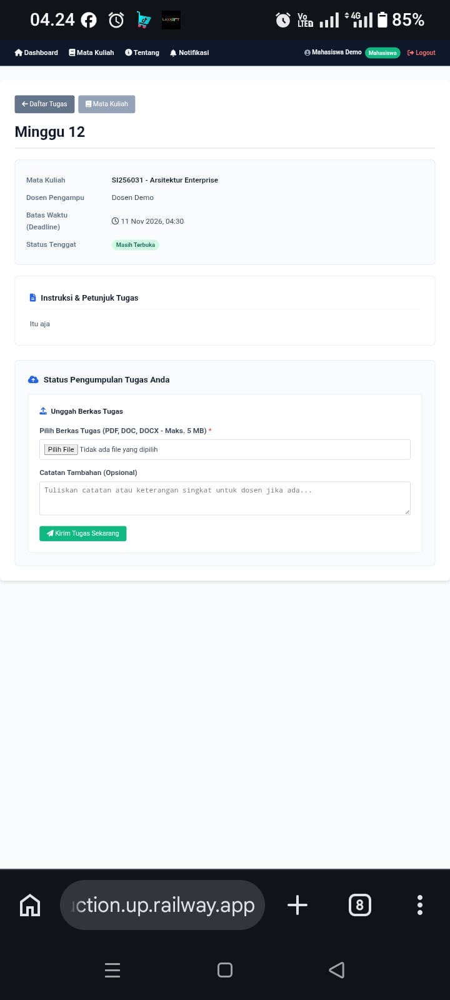

# Catatan Praktikum Modul Minggu 12 — Deployment Produksi dan Keamanan

- **Nama:** Tresia Uyang
- **NIM:** 10241072
- **Kelas:** Pemrograman Web (Kelas B - Kelompok 07)

---

## 1. READ — Bedah Server

### 1. Konfigurasi web server dan document root

Server produksi proyek ini menggunakan Apache di dalam Docker, bukan Nginx. Pengaturan document root terdapat di `Dockerfile`:

```dockerfile
ENV APACHE_DOCUMENT_ROOT /var/www/html/public
```

Konfigurasi Apache kemudian diarahkan ke folder `/var/www/html/public`. Jika menggunakan Nginx, baris yang setara adalah `root /var/www/html/public;`. Document root diarahkan ke folder `public/` agar berkas aplikasi seperti `.env`, `composer.json`, dan `storage/` tidak menjadi berkas publik.

### 2. Perbedaan lingkungan produksi dan lokal

| Pengaturan | Produksi (Railway) | Lokal (Laragon) |
|---|---|---|
| `APP_ENV` | `production` | `local` |
| `APP_DEBUG` | `false` | `true` untuk membantu debugging |
| `APP_URL` | Domain publik HTTPS KampusLMS | `http://localhost` |
| Database | MySQL terkelola Railway | MySQL lokal |
| Session | Database dengan cookie aman untuk HTTPS | Database lokal |
| Web server | Apache dalam container Docker | Server pengembangan lokal |

Produksi menggunakan domain HTTPS dan mode debug nonaktif. Lokal menggunakan alamat localhost dan debug aktif agar masalah saat pengembangan lebih mudah ditelusuri.

### 3. Status worker Supervisor

Pada pemeriksaan status Supervisor yang terdokumentasi, terdapat **2 worker** dan keduanya berstatus `RUNNING`. Worker memproses job antrean di latar belakang, seperti pengiriman notifikasi. Bukti tangkapan layar tersedia di `docs/images/supervisor.png`.

### 4. Pemeriksaan `storage/logs/laravel.log`

Log lokal mencatat **534 entri**. Entri terbaru yang tercatat bertanggal **4 November 2026 pukul 00:08:37**, dengan level `ERROR`. Isinya berkaitan dengan lazy loading relasi `lecturer` pada model `Course` di halaman daftar mata kuliah. Pesan tersebut menunjukkan relasi diakses tanpa eager loading.

### 5. Hasil pemeriksaan keamanan dengan `curl -I`

Tiga alamat dari daftar periksa diperiksa pada domain produksi:

1. `/.env` menghasilkan **404 Not Found**, sehingga file environment tidak dapat diunduh secara publik.
2. `/storage/logs/laravel.log` menghasilkan **404 Not Found**, sehingga log aplikasi tidak terekspos.
3. `/composer.json` menghasilkan **404 Not Found**, sehingga file konfigurasi dependensi di root proyek tidak dapat diakses.

Pemeriksaan tambahan untuk URL HTTP menunjukkan **308 Permanent Redirect** ke HTTPS.

### 6. Pengujian dari perangkat ponsel

Aplikasi diuji dari **Xiaomi Redmi Note 12, Android 13, menggunakan Chrome Mobile**. Halaman mahasiswa, detail tugas, dan formulir unggah berkas dapat digunakan. Tombol mudah disentuh dan pemilih berkas di ponsel berfungsi. Bukti tangkapan layar tersedia di `docs/images/image-3.png`.

---

## 2. BUILD — Milestone M4

### 1. Aplikasi live di domain publik dengan HTTPS

Aplikasi KampusLMS dapat diakses melalui [domain produksi Railway](https://kampuslms-b-kelompok-07-production.up.railway.app). Tautan aplikasi live juga dicantumkan di bagian atas `README.md`.

### 2. Checklist keamanan produksi

`docs/deployment.md` mencatat hasil pemeriksaan 12 parameter keamanan produksi. Beberapa bukti akses berkas dan protokol:

```text
curl -I https://kampuslms-b-kelompok-07-production.up.railway.app/.env
-> HTTP 404 Not Found
curl -I https://kampuslms-b-kelompok-07-production.up.railway.app/storage/logs/laravel.log
-> HTTP 404 Not Found
curl -I https://kampuslms-b-kelompok-07-production.up.railway.app/composer.json
-> HTTP 404 Not Found
curl -I http://kampuslms-b-kelompok-07-production.up.railway.app/
-> HTTP 308 Permanent Redirect ke HTTPS
```

Checklist juga mencatat `APP_ENV=production`, `APP_DEBUG=false`, cookie sesi `secure`, submission pada disk privat, queue worker aktif, serta konfigurasi batas unggahan.

### 3. Skrip `deploy.sh`

Skrip tersedia di root repository dan berisi urutan deployment dengan `set -e`, pemasangan dependensi, build aset, migrasi, pembaruan cache, restart worker, health check, dan pemulihan dari maintenance. Bagian inti yang memastikan migrasi, cache, dan worker diperbarui:

```bash
php artisan migrate --force
php artisan optimize:clear
php artisan optimize
php artisan queue:restart
php artisan about > /dev/null 2>&1 || exit 1
```

### 4. Supervisor dan queue worker

Dokumentasi deployment mencatat dua worker Supervisor aktif dengan status `RUNNING`. Contoh konfigurasi program yang dicantumkan di `docs/deployment.md`:

```ini
[program:kampuslms-worker]
command=php /var/www/kampuslms/artisan queue:work database --sleep=3 --tries=3 --max-time=3600 --timeout=90
autostart=true
autorestart=true
numprocs=2
```

Bukti status worker disimpan di `docs/images/supervisor.png`.

### 5. Isi `docs/deployment.md`

Dokumentasi menjelaskan spesifikasi produksi Railway (1 vCPU, RAM 512 MB–1 GB, container Docker `php:8.4-apache`, PHP 8.4, dan MySQL 8 terkelola), langkah deployment dari awal, deployment ulang melalui Git push atau `deploy.sh`, serta cara membaca log Railway, Laravel, dan worker. Dokumen itu juga mencatat lima masalah deployment dan cara mengatasinya.

### 6. Hasil `scripts/test-authz.sh` pada server produksi

Skrip dijalankan dengan target domain produksi. Hasil yang dicatat di `docs/deployment.md` menunjukkan seluruh pemeriksaan **100% lolos**:

```text
Guest GET /courses                       -> 302
Guest GET /api/v1/me                     -> 401
Mahasiswa POST /courses                  -> 403
Dosen mengubah mata kuliah dosen lain    -> 403
Mahasiswa membuka submission orang lain -> 403
Mahasiswa membuka materi kelas lain     -> 403
Seluruh pemeriksaan                     -> 100% LOLOS
```

### 7. Akun demo produksi

Dokumentasi mencatat bahwa akun demo untuk tiga peran—admin, dosen, dan mahasiswa—berhasil login di server produksi. Setiap peran juga berhasil membuka fitur sesuai hak aksesnya, seperti manajemen pengguna, kelas yang diampu, atau mata kuliah terdaftar.

### 8. Pengujian aplikasi dari ponsel

Saya menguji aplikasi dari Xiaomi Redmi Note 12 (Android 13) menggunakan Chrome Mobile dan jaringan seluler. Halaman mahasiswa, detail tugas, serta formulir unggah berjalan; tombol mudah digunakan dan pemilih berkas ponsel berfungsi. Bukti pengujian tersedia di `docs/images/image-3.png`.


